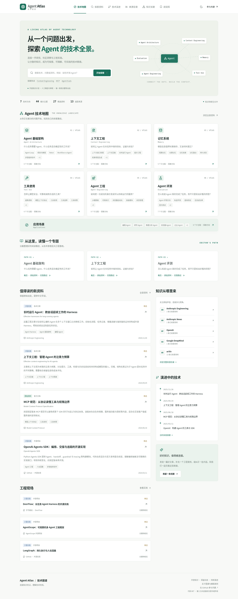

# Agent Atlas · Agent 技术图谱

**以问题为起点，连接 AI Agent 的原始研究、中文解读与工程实践。**

Agent Atlas 1.0 是面向中文 AI 工程师的开源知识平台。读者可以沿主题与证据关系探索资料，编辑团队可以持续收录、修订、审核和发布内容。应用面向单实例、小团队运营，提供持久化数据、编辑历史、采集调度、备份恢复与容器部署；无需模型 API Key 即可完整使用基础流程。



更多页面及真实截图见 [界面说明](docs/screenshots/README.md)。

## 产品能力

- **知识探索**：技术地图、主题层级、跨主题阅读路径、文章档案、来源目录、发布时间线。
- **搜索与关系**：中文/英文多关键词搜索，按相关度或发布时间排序，组合筛选与稳定分页；有向关系图、节点聚焦、证据列表和十种关系类型。
- **个人阅读**：收藏、已读状态、阅读库搜索、JSON 导入导出。记录保存在当前浏览器，最多 500 条，不自动跨设备同步。
- **编辑工作台**：URL/公众号链接、JSON/CSV 收录，导读、作者、机构、工程案例与主题维护，审核发布、驳回与归档。
- **编辑保护**：乐观并发校验、事务化版本快照、历史差异、恢复到待审核、操作审计；主题层级禁止循环，删除与修改标识会检查引用。
- **持续采集**：RSS/Atom、GitHub 网页元数据、规范链接去重、分类建议、条件请求、按来源间隔调度、持久任务租约、失败隔离、手动重试。
- **可选 AI**：OpenAI 兼容接口生成中文标题、导读、关键词和工程案例草稿；机器建议与审核内容分开，不自动发布。
- **部署与运营**：Node.js 或非 root Docker/Compose、健康检查、在线一致性备份、受确认保护的离线恢复、无密钥构建和运行时认证配置。
- **阅读体验**：中文优先、响应式、浅色/深色模式、空状态、错误反馈；配置公开站点地址后提供 canonical、RSS、sitemap 和结构化元数据。

初始数据包含 7 个主要方向、44 个细分主题、27 条公开资料和 3 个完整专题。内容 JSON 与代码分离；后续采集生成待审核记录，不计入已发布资料数量。公开页面保留原始出处，不默认重新发布第三方全文。

## 本地启动

需要 **Node.js 24+**、npm 和可写磁盘。备份工具使用 Node 的 SQLite online backup API。

```bash
git clone --branch work https://github.com/Ohmakabaka/agent-atlas.git
cd agent-atlas
npm ci
cp .env.example .env
```

在 `.env` 设置 `ADMIN_PASSWORD`（至少 12 个字符）和 `SESSION_SECRET`（至少 32 个字符）；没有默认口令。可在本机生成随机值，仅保存到 `.env`，不要提交或公开：

```bash
openssl rand -base64 24
openssl rand -hex 32
```

```bash
npm run db:init
npm run dev
```

打开 `http://localhost:3000`，后台入口为 `/admin`。默认 `DATABASE_URL="file:./dev.db"` 指向 `prisma/dev.db`。`db:init` 依次生成 Prisma 客户端、应用已提交迁移、追加缺失种子；重复运行不会覆盖已有编辑，也不是数据库重置命令。

若要在本机验证 RSS 与站点索引，将 `SITE_URL` 设置为实际访问地址，如 `http://localhost:3000`。正式部署使用自己的 HTTPS 地址。

## 开始编辑与采集

1. 登录后台，进入“收录资料”，提交公开 URL 或批量 JSON/CSV。无法抓取元数据时仍可保留链接、人工补全。
2. 校对中文与原始标题、来源、作者、日期、导读、要点和主题。未知信息留空或明确注明，不能用模型输出补造事实。
3. 核对机器建议；有明确依据的工程案例可填写问题、架构、方案、效果与依据。
4. 选择“已发布”并保存。发布要求中文标题、至少 20 字中文导读和至少一个主题。公开查询只返回已发布资料。
5. 后续编辑会保存历史快照。若另一窗口已更新内容，旧窗口保存被拒绝；历史恢复创建新版本并回到待审核，需要再次核对发布。
6. 在来源管理配置 feed 与检查间隔，在采集任务页检查、重试并查看失败原因。长期运行使用独立 worker：

```bash
npm run ingest
npm run ingest -- --source source-mcp-sdk --force
npm run worker
```

worker 按来源到期时间执行，任务使用数据库租约防止同源重叠。自动采集不自动发布。公众号仅支持链接与人工元信息，不要求部署非官方登录态采集工具。

## Docker 部署

先按 `.env.example` 设置编辑凭证和公开 `SITE_URL`：

```bash
docker compose up -d --build
# 可选：持续采集进程
docker compose --profile sync up -d
curl --fail http://127.0.0.1:3000/api/health
```

Compose 默认绑定主机回环地址。正式访问应通过 HTTPS 反向代理；数据库位于命名卷挂载的 `/app/storage/atlas.db`，与仓库 `data/` 种子目录分开。不要使用 `docker compose down -v` 重启服务，它会删除持久卷。

部署、升级、代理、备份与恢复的完整操作见 [运维指南](docs/operations.md) 和 [部署说明](docs/deployment.md)。文档和容器支持不表示本仓库已发布到公网。

## 命令与验证

| 命令                                                  | 用途                                                         |
| ----------------------------------------------------- | ------------------------------------------------------------ |
| `npm run dev`                                         | 开发服务器                                                   |
| `npm run db:generate`                                 | 生成 Prisma 客户端                                           |
| `npm run db:migrate`                                  | 应用已提交迁移                                               |
| `npm run db:seed`                                     | 追加缺失种子，保留已有编辑                                   |
| `npm run db:init`                                     | 一键初始化或补齐数据库                                       |
| `npm run typecheck`                                   | TypeScript 检查                                              |
| `npm test`                                            | 单元与隔离数据库集成测试                                     |
| `npm run build` / `npm start`                         | 构建、启动生产服务                                           |
| `npm run test:e2e`                                    | 对已启动服务运行公开、后台、编辑历史、图谱与阅读库浏览器验证 |
| `npm run ingest`                                      | 检查到期且启用的来源，支持 `--source <来源ID>`、`--force`    |
| `npm run worker`                                      | 持续调度到期来源                                             |
| `npm run db:backup -- <目标.db>`                      | 在线一致性备份，不覆盖已有目标                               |
| `npm run db:restore -- <备份.db> --confirm --offline` | 在确认所有写入进程已停后恢复，保留原数据库                   |
| `npm audit`                                           | 检查当前锁文件依赖公告                                       |

浏览器测试需要 Chromium。没有可用浏览器时执行 `npx playwright install chromium`；Linux CI 可加 `--with-deps`。在隔离测试数据库上启动服务：

```bash
DATABASE_URL="file:./e2e.db" npm run db:init
DATABASE_URL="file:./e2e.db" SITE_URL="http://127.0.0.1:3000" npm run build
# 终端一：仅本机 HTTP 验收使用此 Cookie 开关
DATABASE_URL="file:./e2e.db" SITE_URL="http://127.0.0.1:3000" \
  ALLOW_INSECURE_ADMIN_COOKIE=true npm start
# 终端二：使用与服务相同的测试数据库
DATABASE_URL="file:./e2e.db" SITE_URL="http://127.0.0.1:3000" npm run test:e2e
```

测试读取本地 `.env` 的编辑凭证并清理自己创建的测试内容。服务与测试进程必须使用同一隔离数据库；上述命令使用 `prisma/e2e.db`。可通过 `BASE_URL` 指定端口、`CHROMIUM_PATH` 指定浏览器。不要对真实生产数据库运行编辑闭环测试。

GitHub Actions 配置检查数据库初始化、类型、单元/数据库测试、依赖公告、无编辑密钥构建及浏览器流程。具体测试数量、分阶段提交与验证范围以 [PROGRESS.md](PROGRESS.md) 为准，远端 CI 结果以 GitHub Actions 为准。

## 环境变量

| 变量                                                           | 说明                                                                                            |
| -------------------------------------------------------------- | ----------------------------------------------------------------------------------------------- |
| `DATABASE_URL`                                                 | 默认 `file:./dev.db`，相对 `prisma/`；生产使用持久目录的绝对 `file:` 路径                       |
| `ADMIN_PASSWORD`                                               | 后台口令，至少 12 字符，无默认值；更换后旧编辑会话失效                                          |
| `SESSION_SECRET`                                               | 至少 32 字符，用于会话与匿名客户端签名；更换后旧会话失效                                        |
| `SITE_URL`                                                     | 实际公开站点根地址；未配置不生成虚假的 canonical，RSS 不可用、sitemap 为空                      |
| `PORT`                                                         | Web 端口，默认 3000                                                                             |
| `ALLOW_INSECURE_ADMIN_COOKIE`                                  | 默认 `false`；仅本机 HTTP 生产构建验收设为 `true`，正式部署使用 HTTPS                           |
| `TRUST_PROXY`                                                  | 默认 `false`；仅在受控反向代理后启用                                                            |
| `TRUSTED_CLIENT_IP_HEADER`                                     | 与 `TRUST_PROXY=true` 同时配置，例如 `x-real-ip`；入口必须覆盖客户端提供的值，只接受单一有效 IP |
| `INGESTION_POLL_SECONDS`                                       | worker 每轮完成后的等待秒数，默认 60，限制 5–3600                                               |
| `INGESTION_PROXY_HOSTS`                                        | 逗号分隔的精确受信公开域名，只有这些目标允许由配置代理解析 DNS；不支持通配放行                  |
| `HTTP_PROXY` / `HTTPS_PROXY` / `NO_PROXY`                      | 可选继承出口配置；代理必须执行目标策略并阻止私网目的地，小写同名变量也受支持                    |
| `INGESTION_CA_FILE`                                            | 可选可信 CA 文件；运行环境必须可读，容器中按需只读挂载，不能通过关闭 TLS 校验替代               |
| `NODE_EXTRA_CA_CERTS` / `SSL_CERT_FILE` / `REQUESTS_CA_BUNDLE` | 采集传输支持的 CA 配置回退，详见适配器指南                                                      |
| `AI_API_KEY`                                                   | 可选；未配置时规则建议与人工流程正常运行                                                        |
| `AI_BASE_URL` / `AI_MODEL`                                     | 默认 `https://api.openai.com/v1`、`gpt-4o-mini`；按兼容服务设置                                 |

认证默认用签名匿名客户端标识隔离登录限流，另有较高的全局保护额度；计数保存在数据库。不要把不可信的转发头当成客户端身份。模型请求只发送有限元数据，输出单独保存为待核对草稿。

## 架构与贡献

技术栈为 Next.js App Router、React、TypeScript、Tailwind CSS、Prisma、SQLite。Prisma 使用 JavaScript 查询引擎与 libSQL 适配器。基础运行不需要图数据库、队列、向量库或第三方身份服务。

```text
src/app/                 公开页面、后台、健康与公开资料接口
src/components/          导航、图谱、阅读控件、文章卡片
src/lib/search/          参数绑定检索、关系与 SEO
src/lib/editor/          版本化编辑、主题层级与引用保护
src/lib/ingestion/       适配器、安全传输、去重与持久调度
src/lib/ai/              可替换模型接口与草稿处理
src/lib/auth.ts          会话、持久限流与认证审计
prisma/                  模型、迁移与种子程序
data/                    可独立贡献的主题、资料、来源和关系 JSON
scripts/                 同步、worker、备份与恢复
tests/                   单元、数据库与浏览器验证
docs/                    架构、内容准则、部署、运维与截图
```

- [架构与数据模型](docs/architecture.md)
- [部署说明](docs/deployment.md) · [健康检查、备份与恢复](docs/operations.md)
- [采集适配器与代理](docs/ingestion.md)
- [内容与主题格式](docs/content.md) · [贡献指南](CONTRIBUTING.md)

## 运行边界

- 当前采用 SQLite 单实例部署，尚未迁移 PostgreSQL，也不提供企业多角色权限。版本历史、审计和持久租约已实现，但不代表具备分布式高可用能力。
- 搜索支持中文子串、字段权重与组合筛选，不是语义问答或向量检索。阅读库仅保存在当前浏览器，跨设备迁移通过导出/导入完成。
- 当前环境已验证真实 GitHub MCP SDK feed 收录与条件请求 304；OpenAI feed 仍被环境域名策略拒绝。不同来源及真实模型服务需要在实际部署出口验证，不能将协议测试等同线上模型验收。
- 种子采用真实公开链接，但部分机构站点受到访问限制，未逐条现场核实所有元信息；应继续依据原始资料纠错。不要补造日期、访谈或工程指标。
- 不提供公众号登录态采集、反爬绕过、WeRSS 内置服务、自动全文翻译或未经审核的自动发布。

## 许可证与第三方内容

仓库自有代码遵循 [MIT License](LICENSE)。第三方文章、论文、图片、商标、源站摘录及所链接项目遵循各自权利人和许可证；链接收录不意味着它们采用 MIT。默认保存元信息、原文链接、原创导读和关联数据，不批量复制全文。内容贡献要求见 [内容与版权准则](docs/content.md)。
