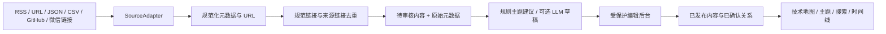

# 架构与数据模型

Agent Atlas 是一个 Next.js 单体应用。服务器组件读取数据库，编辑写入通过受保护的 Server Actions 执行；采集 CLI 与后台使用相同领域逻辑。页面 JSX 不保存种子资料，`data/` 是独立的贡献入口。

## 实体

| 实体                             | 职责                                                 |
| -------------------------------- | ---------------------------------------------------- |
| `Topic`                          | 主题、父子层级、核心问题、关键概念与阅读路径         |
| `Article`                        | 内容元信息、中文导读、状态与审核时间                 |
| `Source`                         | 平台、来源 URL、可选订阅 URL、启用状态和最近检查时间 |
| `Organization`                   | 机构归属                                             |
| `Person`                         | 人物与作者信息                                       |
| `EngineeringCase`                | 有来源依据的问题、架构、方案、效果与边界             |
| `Relation`                       | 文章/主题之间的有类型、有方向关系及其证据            |
| `IngestionJob`                   | 采集任务状态、计数与错误                             |
| `ArticleTopic` / `ArticlePerson` | 多对多主题与人物关联                                 |
| `ArticleLink`                    | 同一内容的原始、规范、转载或补充链接                 |

权威结构为 [`prisma/schema.prisma`](../prisma/schema.prisma)。SQLite 外键、唯一约束与索引保护基本数据一致性；跨实体发布条件和关系端点规则在应用层校验。

## 内容与关系边界

内容状态是 `discovered → pending_review → published → archived`。编辑可以修订或退回已有内容；公开查询只返回 `published`。

`Article.rawMetadata` 保存采集元数据，`Article.aiDraft` 保存机器建议，`title`、`summary`、`takeaways`、`audience` 等字段保存编辑确认的展示内容。AI 操作不自动改写公开内容。

关系类型为 `explains`、`implements`、`discusses`、`compares_with`、`references`、`extends`、`challenges`、`related_to`。每条记录从一个文章或主题指向另一个文章或主题；`suggested` 表示建议，`confirmed` 表示人工确认。公开查询过滤未确认关系以及关联到未发布文章的关系。确认关系必须填写依据 URL。

主题父子层级表示分类，不等同于学习前置条件。阅读路径是编辑建议，不等同于历史因果。时间线按原文发布日期组织，不从时间顺序推断继承关系。

## 查询与检索

`src/lib/queries.ts` 集中公开查询。搜索以多个空白分隔词作 AND 条件，每个词可命中中文标题、原始标题、中文导读、作者和主题名称。可组合主题、机构、来源、平台、类型、资料层次、语言、质量和日期区间，结果分页。

当前采用数据库字符串包含匹配，适合初期资料规模。迁移到全文索引时应保留相同过滤语义，并用中文数据测试召回与排序；不能把无结果的复杂问句搜索宣称为语义问答。

## 数据库与扩展

SQLite 默认存放在 `prisma/dev.db`，Prisma 使用 JavaScript 查询引擎和 libSQL 适配器。保持 `schema.prisma` 与版本化 SQL 迁移同步。迁移与客户端生成通过 `prisma.config.ts` 使用 JavaScript/WASM 路径，标准 `prisma migrate deploy` 仍然适用。新增迁移必须在空数据库验证：当前 Prisma 6 的 WASM diff 对 SQLite JSON 默认值可能生成未加引号的 `DEFAULT {}` / `DEFAULT []`，应审阅并修正为 SQL 字符串 `DEFAULT '{}'` / `DEFAULT '[]'`；不要把未验证的自动生成 SQL 直接发布。

迁移到 PostgreSQL 需要显式切换 Prisma datasource、驱动适配器及连接配置，生成并审阅 PostgreSQL 迁移，迁移已有记录，并验证 JSON、日期、排序、事务和大小写搜索语义。现有领域关系和查询边界为迁移保留空间，但不能仅替换 `DATABASE_URL` 就完成迁移。

目前不需要图数据库、独立搜索服务或消息队列。若数据或团队规模增长，优先增加查询索引、持久任务调度、编辑历史和权限模型，再按实际瓶颈拆分服务。
