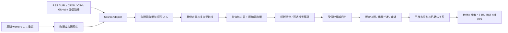

# 架构与数据模型

Agent Atlas 是一个面向单实例、小团队运营的 Next.js 单体应用。服务器组件读取数据库，编辑操作经受保护的 Server Actions 执行；后台、CLI 与 worker 共用采集领域逻辑。SQLite 持久化业务数据、编辑历史、审计、任务租约和限流计数。页面不内嵌种子资料，`data/` 是独立贡献入口。

## 实体与持久化

| 实体                             | 职责                                                          |
| -------------------------------- | ------------------------------------------------------------- |
| `Topic`                          | 递归主题树、核心问题、概念、排序与跨主题阅读路径              |
| `Article`                        | 元信息、中文导读、审核状态和递增编辑版本                      |
| `ArticleRevision`                | 修改前的不可变快照；包含主题、人物、工程案例及展示字段        |
| `Source`                         | 来源、订阅地址、检查间隔、HTTP validators、最近检查/成功/错误 |
| `Organization` / `Person`        | 机构及人物归属                                                |
| `EngineeringCase`                | 带来源依据的问题、架构、方案、效果与边界                      |
| `Relation`                       | 文章/主题之间的有类型、有方向、有证据关系                     |
| `IngestionJob`                   | 采集状态、计数、来源、失败原因与任务详情                      |
| `SyncLease`                      | 来源级持久租约，避免同一来源重叠采集                          |
| `AuditLog`                       | 编辑、主题、来源、关系和认证操作审计                          |
| `RateLimit`                      | 按客户端与共享保护额度记录登录尝试                            |
| `ArticleTopic` / `ArticlePerson` | 资料与主题/人物的多对多连接                                   |
| `ArticleLink`                    | 同一内容的原始、规范和补充链接                                |

权威结构为 [`prisma/schema.prisma`](../prisma/schema.prisma)。外键、唯一约束、事务和应用校验共同保护数据。`ArticleRevision(articleId, version)` 唯一；版本恢复创建新的当前版本，不改写过去的快照。

## 编辑与发布边界

内容状态为 `discovered → pending_review → published → archived`。公开查询只返回 `published`。采集写入原始元数据，机器草稿写入 `aiDraft`，编辑负责可展示的标题、导读、技术要点等字段；模型调用不会自动改变公开内容。

保存携带编辑打开页面时的 `Article.version`。事务内核对版本、验证发布条件、保存旧快照、更新关联与工程案例、递增版本并写审计；发生冲突时拒绝过期写入，避免静默覆盖。历史页支持查看差异；恢复旧快照仍遵守当前校验，并将状态设回 `pending_review`，需要重新审核。驳回记录原因并归档，保留历史。

后台主题管理允许多层分类和跨主题阅读路径。父子循环被拒绝；有资料、子主题或关系引用的主题不能直接删除或修改 URL 标识。阅读路径只接受已发布资料，公开查询按编辑顺序显示，后续归档条目不会继续公开。

## 关系与图谱

关系类型为 `explains`、`implements`、`discusses`、`compares_with`、`references`、`extends`、`challenges`、`related_to`、`prerequisite_for`、`evolves_from`。每条记录恰有一个起点和一个终点；`suggested` 为未审核建议，`confirmed` 为人工确认。确认需要依据 URL，公开图谱还会检查文章端点已发布。

`/graph` 提供关系图、节点聚焦与等价证据列表；支持主题和类型过滤。图形位置不代表时间或重要性，关系方向以类型与证据说明为准。分类父子、编辑阅读顺序、发布日期先后均不会自动变成技术继承关系。

## 检索与个人阅读

`src/lib/search/query.ts` 使用参数绑定 SQL。输入进行 Unicode 规范化、大小写与空白处理，多关键词按 AND 匹配；标题、原始标题、主题、作者和摘要采用不同权重。搜索支持相关度、新到旧、旧到新排序及稳定分页；机构、来源、平台、资料层次、语言、质量、日期等可组合过滤。主题过滤递归包含全部后代。

这是中文子串和字段权重检索，不是语义问答。后续迁移全文索引时，应保留过滤、审核边界、稳定排序与分页语义，用中文样本验证召回。

个人阅读记录在浏览器 localStorage 中保存 slug、标题、收藏/已读状态与更新时间，支持最多 500 条及 JSON 迁移。公开资料查询接口只返回已发布条目的必要字段；归档记录仍可留在用户本地，但不通过接口泄露私有正文。个人状态没有服务器账户同步。

## 采集与安全

采集器执行规范化、去重、建议和待审入库；worker 检查到期来源。HTTP validators 避免反复下载未变化 feed，来源级数据库租约协调并发。失败单独记录，不阻断其他来源；进程中断后的过期任务可以被后续检查回收。

直连请求验证并固定公开 DNS 地址；代理模式仅接受明确允许的受信公开主机，并要求上游代理阻止私网目的地。TLS、响应体上限、超时和重定向检查始终保留。详见 [采集指南](ingestion.md)。

后台每个写入均检查会话；动态路由在运行时读取凭证，不把构建时是否配置密码固化为页面。会话与匿名客户端签名隔离，登录预算持久化。仅明确配置受信反向代理和被覆盖的单 IP 头时才使用转发地址。该系统没有企业角色或多人独立账号模型。

## 运行与迁移

Node.js 要求 24+。SQLite 默认位于 `prisma/dev.db`；Prisma 使用 JavaScript 查询引擎和 libSQL 适配器，生成和迁移通过 `prisma.config.ts` 的 JS/WASM 路径执行。`schema.prisma` 与提交的 SQL 迁移必须保持一致，并验证空库和已有数据升级。Prisma 6 的 WASM diff 对 SQLite JSON 默认值可能生成未加引号的 `DEFAULT {}` / `DEFAULT []`，应审阅为有效 SQL 字符串并测试，不能盲目发布生成结果。

升级前在线备份；恢复需停止全部写入进程并显式确认。健康检查验证迁移和数据库可用性，不输出内部路径。Docker 持久卷位于 `/app/storage`，不能覆盖存放种子的 `/app/data`。操作步骤见 [运维指南](operations.md)。

PostgreSQL 迁移需要切换 datasource、驱动和连接配置，审阅目标迁移、搬迁数据并复验 JSON、日期、SQL 方言、事务、排序和锁；不是替换 `DATABASE_URL` 即可完成。当前不声称分布式高可用，也未引入图数据库、向量库或微服务。

## 依赖升级与验证

当前锁文件使用 Zod 4.6.6+、csv-parse 7.0.2+。Prisma 6 配置依赖中的 `deepmerge-ts` 通过 npm override 升级到 8+，以处理已知依赖公告；此次已验证客户端生成、数据库迁移、类型检查和完整测试。升级 Prisma 或移除 override 时应重新执行这些检查，不要仅依据安装成功判断兼容。
